<div align="center">

# Inventory Intelligence

**Single-SKU stock and material planning workspace — from one Excel workbook to a full decision picture.**

[](https://www.python.org/)
[](https://streamlit.io/)
[](https://pandas.pydata.org/)
[](https://plotly.com/)
[](https://www.reportlab.com/)
[](https://github.com/mertkk1623/inventory-intelligence/actions)
[](https://github.com/mertkk1623/inventory-intelligence/actions)
[](https://docs.astral.sh/ruff/)
[](#)

**English** · [Türkçe](README_TR.md)

</div>

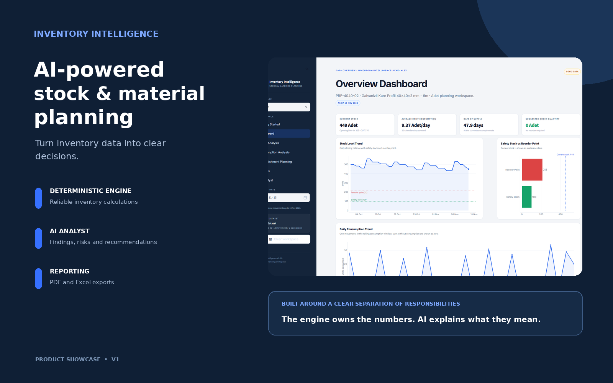

*Cover image. The three layers of the product — deterministic engine, AI Analyst
and reporting — alongside the Overview Dashboard rendered from the bundled demo
dataset.*

---

## Table of Contents

1. [Project Overview](#1-project-overview)
2. [Key Features](#2-key-features)
3. [AI Analyst — Intelligent Inventory Insights](#3-ai-analyst--intelligent-inventory-insights)
4. [How It Works](#4-how-it-works)
5. [Deterministic Engine vs AI Layer](#5-deterministic-engine-vs-ai-layer)
6. [Reports & Exports — PDF and Excel](#6-reports--exports--pdf-and-excel)
7. [Application Screenshots](#7-application-screenshots)
8. [Technology Stack](#8-technology-stack)
9. [Installation & Setup](#9-installation--setup)
10. [AI API Configuration](#10-ai-api-configuration)
11. [Project Architecture](#11-project-architecture)
12. [Testing & Quality Assurance](#12-testing--quality-assurance)
13. [Limitations](#13-limitations)
14. [Security Notes](#14-security-notes)

---

## 1. Project Overview

Inventory Intelligence turns a single Excel workbook into a working decision
surface for one stock-keeping unit. Instead of rebuilding stock mathematics in
spreadsheets, you upload the workbook once and the application derives the whole
picture from it: how much stock is on hand, how fast it is consumed, when a
reorder becomes necessary and how large that order should be.

The product is built on a strict separation of responsibilities:

| Layer | Responsibility |
| --- | --- |
| **Calculation engine** | Owns every number. Current stock, consumption, thresholds and order suggestions are produced by a framework-independent Python package that has no UI imports. |
| **Interface** | Only presents. No screen recalculates a metric. |
| **AI Analyst** | Only explains. It receives engine values and writes prose about them; it cannot modify a value. |

V1 is deliberately narrow — one product, one warehouse, one workbook. That
constraint keeps every calculation auditable and the scope honest.

> **Scope note.** The bundled dataset is synthetic and clearly labelled as demo
> data throughout the interface.

---

## 2. Key Features

### Data contract and validation

- **Structured Excel contract.** Three required sheets (`Product Master`,
  `Stock Movements`, `Open Orders`) with fixed column names, validated before
  anything is calculated.
- **Row-level validation feedback.** Every problem is reported with a code, a
  severity and a plain-language message in the selected interface language.
- **Demo and upload isolation.** The synthetic demo dataset and your own uploads
  never coexist in the same workspace.

### Deterministic calculation

- **Current stock, rolling average daily consumption, days of supply.** Computed
  over a rolling 30-calendar-day window; days without movements count as zero
  rather than being skipped.
- **Reorder point, target stock, inventory position, suggested order quantity.**
  All derived from the validated workbook and the sidebar report date.
- **Historical report dates.** Selecting a past date explains which planning
  values are intentionally unavailable instead of guessing.

### Interface

- **Seven screens** — Getting Started, Overview Dashboard, Stock Analysis,
  Consumption Analysis, Replenishment Planning, Reports and AI Analyst.
- **Interactive charts** — stock balance trend, daily and weekly consumption, and
  a safety-stock-versus-reorder-point comparison.
- **Bilingual interface** — complete English and Turkish UI with locale-aware
  number and date formatting.
- **No silent failures** — a missing API key, an unreachable provider or a
  truncated response produces a visible message while deterministic values stay
  intact.

### Output

- **Excel and PDF reporting** — a five-sheet workbook and a seven-section A4 PDF,
  both generated from the same calculation result.
- **Optional AI interpretation** — inventory insights, consumption insights, a
  replenishment explanation and free-form questions, cached per dataset and
  report date.

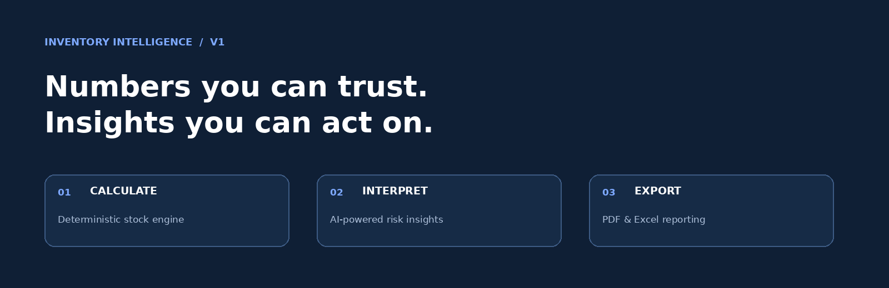

*The product in three moves — deterministic calculation, AI interpretation,
and PDF/Excel export.*

---

## 3. AI Analyst — Intelligent Inventory Insights

The AI Analyst is an optional interpretation layer on top of the deterministic
engine. It is a bounded client, not an autonomous planner: it reads the numbers
the engine produced and explains them in plain language.

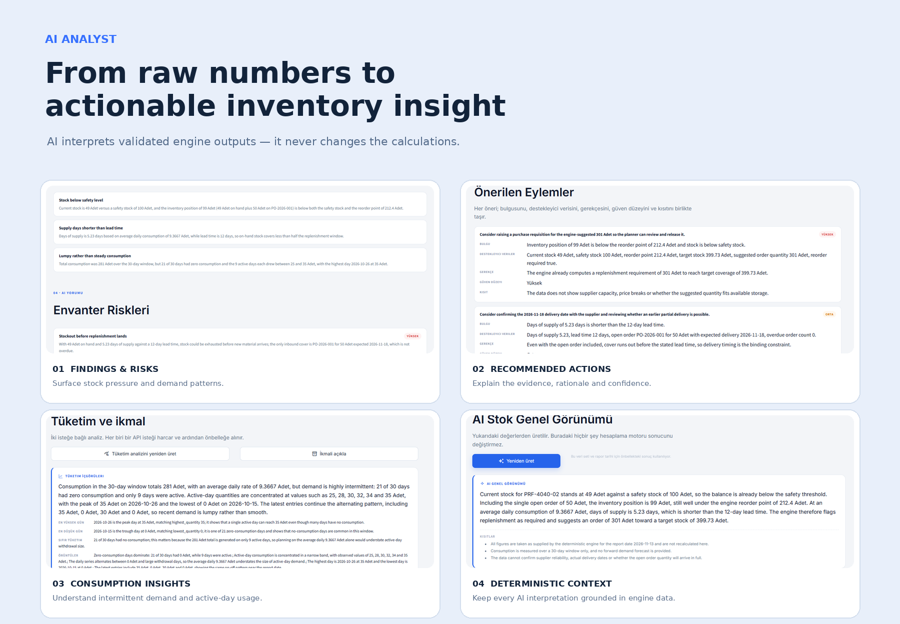

*The four AI Analyst output surfaces in one view: findings and risks,
recommended actions with their supporting data and confidence, consumption
insights, and the inventory overview. The Turkish panel headings illustrate the
bilingual interface; model output itself is English.*

> **Note on the figures.** These panels come from a **different dataset state**
> than the demo workspace used in the rest of this document: 49 Adet on hand and
> a suggested order of 301 Adet, where the demo workbook has 449 Adet and no
> reorder. The numbers are therefore **illustrative and do not belong to the same
> session** as the other screenshots. They show what AI output looks like, not
> the demo results.

### What it does

| Capability | Description |
| --- | --- |
| **AI-generated inventory overview** | A narrative summary of the current stocking position, derived strictly from engine values. |
| **Automated findings and risk identification** | Structured findings and risks, each with a title, a severity and a detail line. |
| **Action recommendations** | Suggested actions with the supporting data, the reason and an explicit confidence level and limitation. |
| **Consumption pattern analysis** | A summary of the consumption window with peak day, lowest day, zero-consumption notes and observed patterns. |
| **Replenishment insights** | An explanation of why a reorder is or is not required, with supporting data and caveats. |
| **Natural-language inventory Q&A** | Free-form questions about the active dataset, plus six suggested questions offered as one-click buttons. |
| **Deterministic data grounding** | Every value the model is allowed to cite comes from the engine result shown in the supporting-data panel. |
| **Interpretation without touching calculations** | The AI never writes back into the engine, the dashboard or the reports. |

### What it cannot do

- It **cannot change a calculation**. Every number in the supporting-data panel
  comes from `InventoryCalculation`.
- It **cannot run on its own**. A request is sent only when you press an AI
  button, and each request is an explicit action.
- It **cannot produce a purchase order**, a multi-SKU plan or a forecast. Those
  are outside V1 scope.
- It **cannot silently fail**. Provider errors and truncated responses surface as
  banners while deterministic values remain on screen.

### How requests are controlled

- Responses are validated against strict Pydantic schemas: lists capped at **15
  items**, text fields at **1,200 characters**, individual items at **400
  characters**.
- Every successful result is cached by a **context fingerprint plus operation**,
  so a Streamlit rerun never repeats a request and the same question is never
  billed twice. Failures are never cached.
- A response that hits the token ceiling (`finish_reason == "length"`) is rejected
  as truncated rather than presented as complete.
- Open purchase orders are never folded into current stock anywhere in the
  pipeline, and the AI is instructed accordingly.

### Language

The **interface** is fully translated. **Model output is English** — the prompt
requests English prose and answers are rendered verbatim. The AI Analyst screen
states this explicitly so a Turkish interface is never surprising.

---

## 4. How It Works

The workflow has eight steps, mirrored on the Getting Started screen.

1. **Download Excel Template** — start from a workbook that already contains the
   required sheets and columns.
2. **Enter Product and Stock Data** — add the SKU, opening stock, safety stock and
   planning parameters.
3. **Upload Excel File** — every sheet is validated before the file becomes
   active.
4. **Review Inventory Dashboard** — check current stock, days of supply, reorder
   point and suggested order quantity.
5. **Analyze Consumption** — inspect daily and weekly OUT consumption, including
   days with no movement.
6. **Review Replenishment Recommendations** — compare inventory position with the
   reorder point and review open purchase orders.
7. **Ask AI Analyst** — optionally request a plain-language explanation (requires
   an API key).
8. **Export Excel or PDF Reports** — download a formatted workbook or a
   presentation-ready PDF for the selected report date.

### Calculation model

| Metric | Formula |
| --- | --- |
| Current Stock | Opening Stock + IN movements − OUT movements, up to the report date |
| Average Daily Consumption | OUT quantity in the consumption window ÷ calendar days in that window |
| Days of Supply | Current Stock ÷ Average Daily Consumption (`—` when consumption is zero) |
| Reorder Point | Average Daily Consumption × Lead Time Days + Safety Stock |
| Target Stock | Average Daily Consumption × (Lead Time Days + Target Coverage Days) + Safety Stock |
| Inventory Position | Current Stock + all open order quantities |
| Reorder Required | Inventory Position ≤ Reorder Point (inclusive) |
| Suggested Order Quantity | `0` when no reorder is required; otherwise ceil(Target Stock − Inventory Position) |

### Worked example

Using the bundled demo workbook with a report date of 13 November 2026:

| Value | Result |
| --- | --- |
| Current Stock | 449 Adet |
| Average Daily Consumption | 9.37 Adet/day |
| Days of Supply | 47.9 days |
| Reorder Point | 212.4 Adet |
| Target Stock | 399.7 Adet |
| Open Order Quantity | 300 Adet |
| Inventory Position | 749 Adet |
| Suggested Order Quantity | 0 Adet |

Inventory Position (749) is above the Reorder Point (212.4), so no reorder is
required and the suggestion is zero. These numbers are reproducible from the
bundled file; they are not hard-coded.

### Excel data structure

The workbook is the entire input contract. Three sheets are required, with these
exact names and columns.

**`Product Master`** — one row, describing the single SKU:

| Column | Meaning |
| --- | --- |
| `Product Code` | SKU identifier |
| `Product Name` | Display name |
| `Unit` | Unit of measure (for example `Adet`) |
| `Opening Stock` | Stock level on the opening date |
| `Opening Stock Date` | Start of the movement history |
| `Safety Stock` | Minimum planning buffer |
| `Lead Time Days` | Expected supplier lead time |
| `Target Coverage Days` | Coverage the target stock should provide |

**`Stock Movements`** — one row per movement:

| Column | Meaning |
| --- | --- |
| `Date` | Movement date |
| `Transaction Type` | `IN` or `OUT` |
| `Quantity` | Positive quantity |
| `Description` | Free-text note |

**`Open Orders`** — one row per purchase order awaiting delivery:

| Column | Meaning |
| --- | --- |
| `Order No` | Unique order number |
| `Order Quantity` | Ordered quantity |
| `Expected Delivery Date` | Promised delivery date |

### Demo data

The bundled demo workbook is synthetic and exists only to make the application
explorable without preparing data. It is labelled as demo data in the interface
and never mixes with an uploaded workbook.

### Quick Start & sample scenarios

The Getting Started screen opens with a **Quick Start & Demo Data** panel that
removes the need to prepare a file at all:

| Action | What it does |
| --- | --- |
| **🚀 Run the AI demo now** | Generates the selected scenario, validates it through the real engine and opens the dashboard immediately. Nothing is downloaded or uploaded. |
| **📥 Download blank template** | An empty workbook with the exact sheets and column headers, a `Read Me` guide explaining every column and format rule, and an `IN`/`OUT` dropdown on `Transaction Type`. |
| **📊 Download sample data** | The same populated workbook the button above activates, as an `.xlsx` file. It can be inspected, edited and re-uploaded through the normal upload path. |

Four single-SKU scenarios are curated so that the deterministic engine — and
therefore the AI layer — has something specific to explain:

| Scenario | SKU | Signal it demonstrates |
| --- | --- | --- |
| **Stockout risk** | `SKU-IND-1042` | Seasonal demand ramp, stock below safety stock, position under the reorder point, one overdue purchase order. |
| **Dead stock** | `SKU-LEG-2087` | ~4,500 units of idle capital, days of supply in the thousands, no reorder. |
| **Negative stock** | `SKU-PRJ-7001` | A bulk shipment picked before its receipt; the running balance drops to −306 and recovers. |
| **Fast mover** | `SKU-FST-5001` | High steady velocity with healthy cover above the reorder point. |

Each scenario is deliberately single-SKU because V1 plans one product at a
time: the four scenarios contrast **turnover velocity** rather than claiming a
multi-SKU ABC classification, which belongs to V2.

All generated files come from `core/schema.py`, so headers can never drift from
the validator contract, and dates are anchored to the day the workbook is
generated — a scenario never expires and is always treated as a current report.

---

## 5. Deterministic Engine vs AI Layer

This boundary is the central design decision of the project.

| | Deterministic Engine | AI Analyst |
| --- | --- | --- |
| **Role** | Single source of truth for all numbers | Interpretive layer over those numbers |
| **Produces** | Stock, consumption, thresholds, order suggestion | Narrative overview, findings, risks, actions, Q&A |
| **Can change a value** | Yes — it defines them | **No** |
| **Deterministic** | Yes — same input, same output | No — model output varies |
| **Requires network** | No | Yes, and only on explicit user action |
| **Required to use the app** | Yes | No — fully optional |

```text
Excel workbook
      │
      ▼
┌─────────────────────────┐
│  Validation engine      │  rejects malformed workbooks
└───────────┬─────────────┘
            ▼
┌─────────────────────────┐
│  Calculation engine     │  ← the ONLY source of numbers
│  (core/, no Streamlit)  │
└───────────┬─────────────┘
            │  one InventoryCalculation object
   ┌────────┼────────┬─────────────┐
   ▼        ▼        ▼             ▼
Screens   Charts   Excel/PDF   AI Analyst
                               (reads values,
                                cannot write)
```

If the AI layer is disabled, unavailable or erroring, **every deterministic
screen and both reports still work exactly the same**.

---

## 6. Reports & Exports — PDF and Excel

Two outputs are produced from the same `ReportContext`, so downloaded files always
agree with the dashboard.

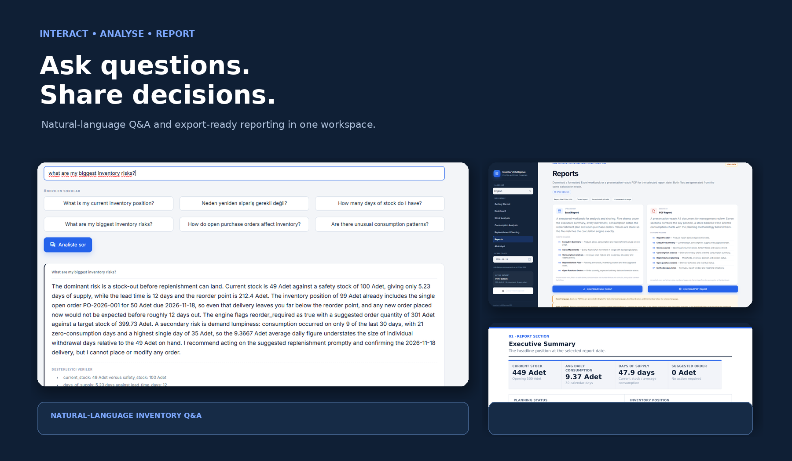

*The two ends of the same workspace: a natural-language question answered from
the deterministic context (left), and the Reports screen with both export
formats plus the executive summary of a generated PDF (right).*

> **Note on the figures.** The left and right panels are **not from the same
> session**. The Q&A answer reflects a dataset state with 49 Adet on hand and a
> suggested order of 301 Adet, while the report panel shows the demo workbook —
> 449 Adet, 9.37 Adet/day and no reorder. Both are genuine rendered output, but
> they were produced from two different dataset states and are combined here for
> presentation only.

### Excel report — five sheets

| # | Sheet | Contents |
| --- | --- | --- |
| 1 | `Executive Summary` | Product, stock, consumption and replenishment values on one page |
| 2 | `Stock Movements` | Every IN and OUT movement in range with its closing balance |
| 3 | `Consumption Analysis` | Average, total, highest and lowest day plus daily and weekly series |
| 4 | `Replenishment Plan` | Planning thresholds, inventory position and the suggested order |
| 5 | `Open Purchase Orders` | Order quantity, expected delivery date and overdue status |

### PDF report — seven sections

Report header, executive summary, stock analysis, consumption analysis,
replenishment planning, open purchase orders, and methodology & notes.

The PDF is A4 portrait with numbered pages, charts drawn from the same series as
the dashboard, and an embedded TrueType font so Turkish characters render
correctly.

### Report language scope

**Excel and PDF files are generated in English**, regardless of interface
language. Dashboard values, charts and the interface follow the selected
language; the report files do not. The Reports screen states this explicitly.
Reports are static snapshots of the current calculation and contain no formulas.

---

## 7. Application Screenshots

All screenshots below were captured from the running application using the
bundled synthetic demo dataset.

### Overview Dashboard

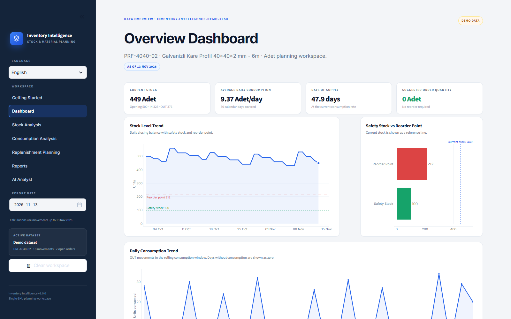

*Four KPI cards, stock level trend, safety-stock-versus-reorder-point comparison,
daily consumption trend, stock status and open purchase order tables.*

### Stock Analysis

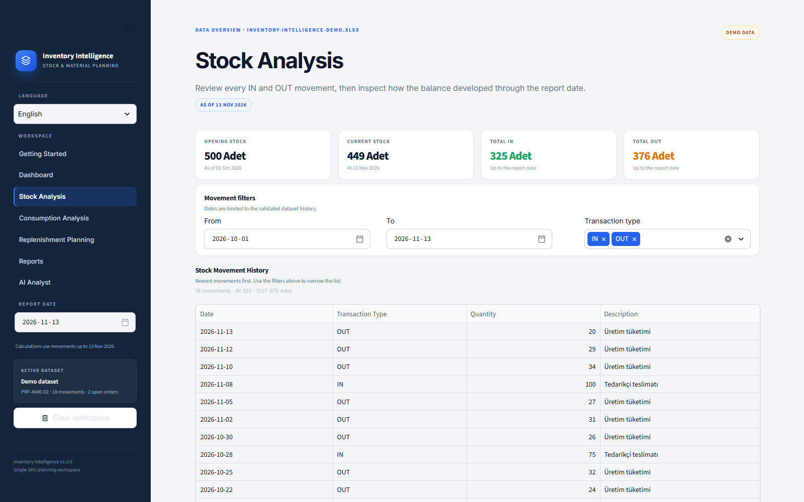

*Opening and current stock, total IN and OUT, movement filters and the full
movement history.*

### AI Analyst

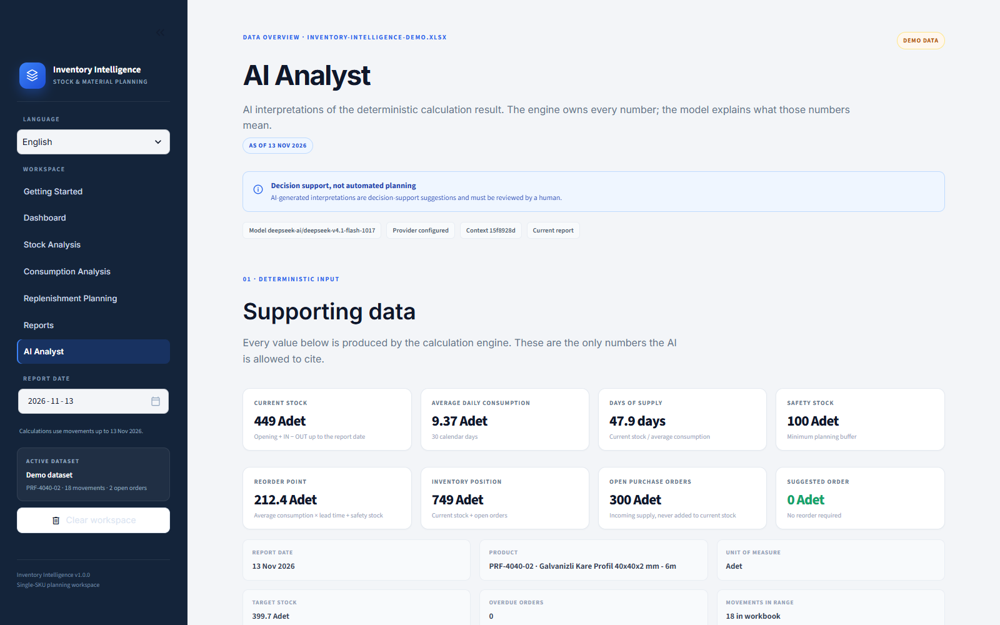

*The deterministic supporting-data panel. Every value here comes from the
calculation engine; the AI is only allowed to cite these numbers.*

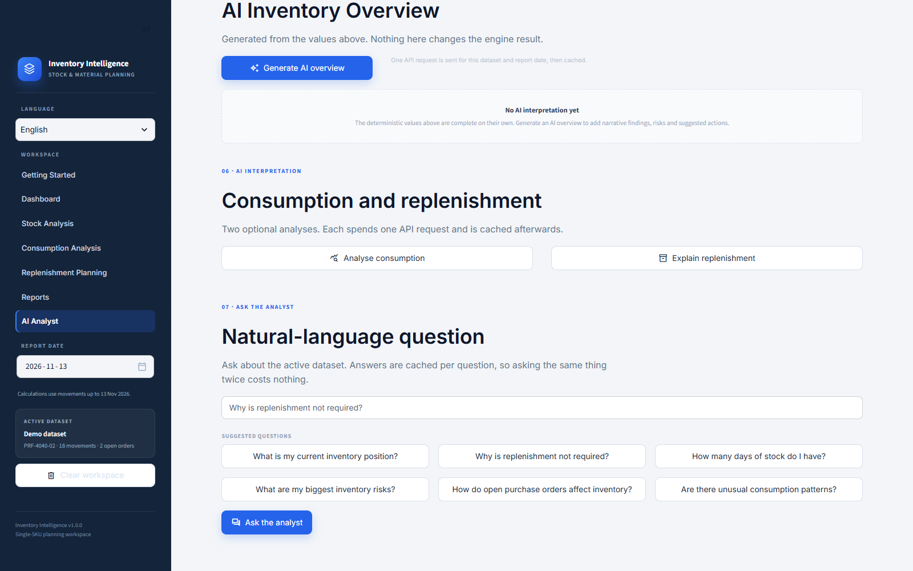

*The AI section scaffolding: the overview generator, the two optional analyses and
the natural-language question box with suggested questions.*

### Consumption Analysis

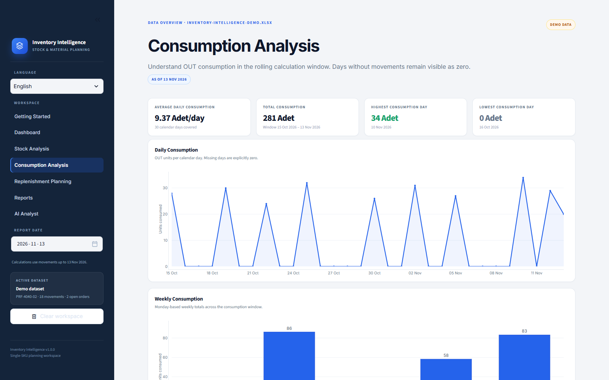

*Average and total consumption, highest and lowest day, daily line chart and
weekly bar chart. Days without movements remain visible as zero.*

### Replenishment Planning

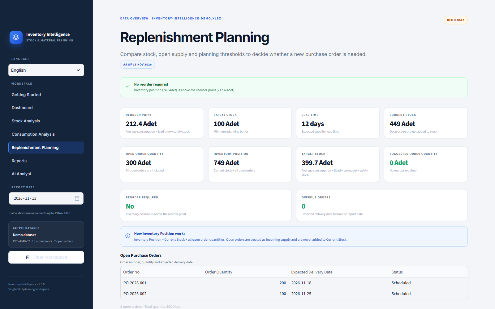

*Reorder point, safety stock, lead time, inventory position, target stock,
suggested order, overdue orders and the open-order table.*

### Reports

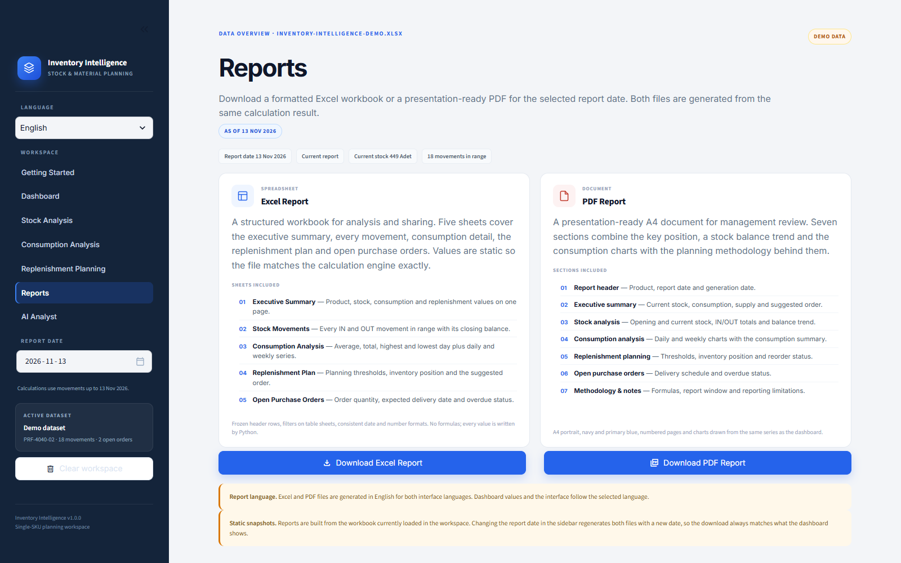

*Both output formats described side by side, with their download buttons.*

### PDF Report

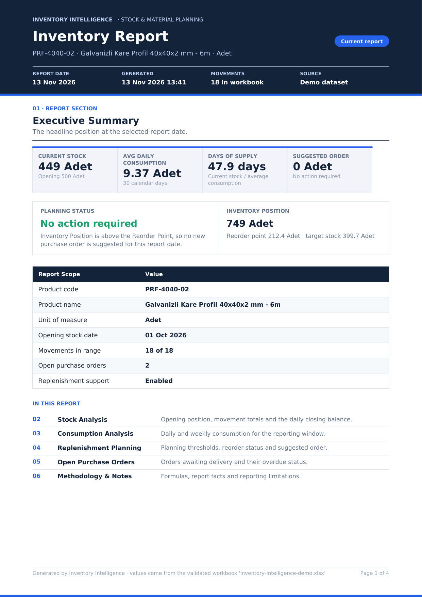

*A real generated A4 report — page 1 of 4, executive summary.*

---

## 8. Technology Stack

| Layer | Choice |
| --- | --- |
| Language | Python 3.11+ (verified on 3.11, 3.12 and 3.13) |
| UI | Streamlit (verified on 1.53 and 1.67) |
| Data | pandas, openpyxl |
| Charts | Plotly |
| PDF | ReportLab |
| AI validation | Pydantic v2 |
| AI transport | Python standard library `urllib` only |
| Tests | pytest with Streamlit's `AppTest` |
| Lint | Ruff |
| CI | GitHub Actions, Python 3.11/3.12/3.13 matrix |

The AI client deliberately has no vendor SDK dependency: one small
OpenAI-compatible `chat/completions` caller keeps both the dependency surface and
the review surface small.

**Runtime dependencies** (`requirements.txt`):

```text
streamlit>=1.53,<2.0
pandas>=2.2,<4.0
openpyxl>=3.1,<4.0
plotly>=5.24,<7.0
reportlab>=4.2,<5.0
pydantic>=2.7,<3.0
```

---

## 9. Installation & Setup

Requirements: **Python 3.11 or newer**.

```bash
git clone https://github.com/mertkk1623/inventory-intelligence.git
cd inventory-intelligence

python -m venv .venv

# Windows
.venv\Scripts\activate

# macOS / Linux
source .venv/bin/activate

pip install -r requirements.txt
```

For development, including the test suite and the linter:

```bash
pip install -r requirements-dev.txt
```

### Run the application

```bash
streamlit run app.py
```

If `streamlit` is not on your PATH:

```bash
python -m streamlit run app.py
```

The app opens at `http://localhost:8501`.

### Run the tests

```bash
python -m pytest -q
```

### Lint

```bash
python -m ruff check .
```

### Upload limits

`.streamlit/config.toml` sets the theme and the 10 MB upload limit; `config.py`
holds `MAX_UPLOAD_SIZE_MB` and the allowed extension (`.xlsx` only).

---

## 10. AI API Configuration

The AI layer is **optional and off unless configured**. Without a key the
application is fully usable: every deterministic screen and both reports work, and
the AI Analyst screen explains that AI is unavailable.

### Configuration precedence

The AI layer resolves its settings from, in order of precedence:

1. `.streamlit/secrets.toml` (never committed)
2. Environment variables
3. Built-in defaults

### Local setup

Create `.streamlit/secrets.toml`:

```toml
# .streamlit/secrets.toml — never commit this file
AI_API_KEY = "your-api-key-here"
AI_BASE_URL = "https://api-cdn.deploy.com/api/v1"   # optional
AI_MODEL = "deepseek-ai/deepseek-v4.1-flash-1017"   # optional
```

Accepted key names are `AI_API_KEY` and `DEPLOY_API_KEY`. `AI_BASE_URL` and
`AI_MODEL` are optional overrides.

### Streamlit Cloud

Do **not** commit the secrets file. In the Streamlit Cloud dashboard:

**⋮ → Settings → Secrets**, then paste:

```toml
AI_API_KEY = "your-api-key-here"
```

Save; the app restarts automatically. `AI_BASE_URL` and `AI_MODEL` may be added
the same way if you need a non-default provider.

### Default provider settings

| Setting | Value |
| --- | --- |
| Base URL | `https://api-cdn.deploy.com/api/v1` |
| Endpoint | `POST /chat/completions` |
| Auth | `Authorization: Bearer <key>` |
| Model | `deepseek-ai/deepseek-v4.1-flash-1017` |
| `max_tokens` | 4000 (a 3000 floor is enforced as the minimum useful budget) |
| `temperature` | 0.2 |
| Timeout | 60 s |
| Retries | 2, on 429/500/502/503/504 only |

---

## 11. Project Architecture

```text
inventory-intelligence/
├── app.py                    Streamlit entry point and page routing
├── config.py                 Paths, app metadata, upload limits
├── pyproject.toml            Ruff and pytest configuration
├── requirements.txt          Runtime dependencies
├── requirements-dev.txt      Runtime + pytest + Ruff
├── .streamlit/config.toml    Theme and upload configuration
├── .github/workflows/ci.yml  Lint and test matrix
├── core/                     Framework-independent domain layer
│   ├── schema.py             Canonical Excel sheet/column contract
│   ├── models.py             Domain models and the calculation result
│   ├── excel_reader.py       Workbook reader
│   ├── validation.py         Validation engine and issue reporting
│   ├── inventory.py          Current stock and balance history
│   ├── consumption.py        Rolling average daily consumption
│   ├── replenishment.py      Reorder point, target stock, order suggestion
│   └── calculations.py       Composes the single InventoryCalculation
├── analytics/series.py       Display series derived from the result
├── ai/                       Optional AI layer (client, prompts, schemas, cache)
├── reports/                  Excel and PDF builders plus PDF theme/charts
├── components/               Screens, charts, sidebar, styles, UI helpers
│   └── quick_start.py         Quick Start & Demo Data panel
├── utils/                    i18n, session state, data loading, calculation cache
│   └── sample_data.py         Blank template and the four demo scenarios
├── templates/                Excel template and synthetic demo workbook
├── docs/screenshots/         Product screenshots used by this README
└── tests/                    pytest suite
```

The `core/` package **never imports Streamlit**. That boundary is what makes the
engine testable without a browser and keeps the screens as presentation only.

### Session isolation

The AI response cache lives in `st.session_state`, not at module level, so one
browser session never shares cached AI output with another. Language selection is
likewise session-scoped.

---

## 12. Testing & Quality Assurance

| Item | Result |
| --- | --- |
| Automated tests | **233**, across 8 modules |
| Verified Python | 3.11, 3.12, 3.13 |
| Verified Streamlit | 1.53, 1.67 |
| Lint | Ruff, clean |
| CI | GitHub Actions — lint + tests on the 3.11/3.12/3.13 matrix |

### Test distribution

| Module | Tests |
| --- | --- |
| `test_ai.py` | 77 |
| `test_sample_data.py` | 43 |
| `test_dashboard.py` | 29 |
| `test_reports.py` | 29 |
| `test_excel_validation.py` | 21 |
| `test_calculations.py` | 20 |
| `test_i18n.py` | 12 |
| `test_app.py` | 2 |
| **Total** | **233** |

The suite covers the Excel contract and its rejection paths, every calculation
formula, report generation, the AI schema validation and caching rules, bilingual
rendering, the generated template and demo scenarios, and the Streamlit app shell
via `AppTest`.

### Continuous integration

`.github/workflows/ci.yml` runs Ruff and the full pytest suite on every push and
pull request to `main`, across Python 3.11, 3.12 and 3.13 on `ubuntu-latest`.
The workflow has run successfully against the current commit.

---

## 13. Limitations

These are intentional V1 boundaries, not defects.

- **Single SKU, single warehouse.** One product row per workbook.
- **No forecasting.** Consumption is measured historically; it is not projected.
- **No ABC analysis, no stock optimisation.** Both are V2/V3 scope.
- **No ERP or accounting integration.** The workbook is the only input.
- **Historical report dates do not produce order suggestions.** Current open
  orders describe today's supply, not the supply that existed on a past date, so
  they are excluded from Inventory Position and the suggestion is suppressed with
  an explanation.
- **Excel and PDF reports are English-only.** The interface and dashboards are
  bilingual; the report files are not.
- **AI output is English-only** and depends on an external provider.
- **Session-only state.** A full page reload clears the workspace.
- **No authentication.** V1 ships no login.
- **The AI layer is decision support.** It is not automated planning and every
  output requires human review.
- **A historical consumption window can be short.** If the workbook covers fewer
  than 30 days, the average is computed over the days that exist.

---

## 14. Security Notes

- **No API key is committed.** `.gitignore` excludes `.streamlit/secrets.toml`,
  `.env`, `.env.*`, `*.pem` and `*.key`. The repository contains no credentials.
- **Keys are never logged or rendered.** The key is read from secrets or the
  environment at request time and is not written to output, logs or reports.
- **Credentials belong to the deployment, not the repository.** On Streamlit
  Cloud the key is supplied through the app's Secrets panel.
- **No outbound calls except the AI request you trigger.** The application makes
  no telemetry or analytics calls; Streamlit usage statistics are disabled in
  `.streamlit/config.toml`.
- **No runtime disk writes.** Uploaded data is held in memory for the session and
  never persisted to disk.
- **No authentication is provided in V1.** Do not load real commercial data into a
  publicly reachable deployment.

---

<div align="center">

**Inventory Intelligence V1** · Single-SKU planning workspace

[English](#inventory-intelligence) · [Türkçe](README_TR.md)

</div>
