<div align="center">

# Inventory Intelligence

**Tek SKU için stok ve malzeme planlama çalışma alanı — tek bir Excel dosyasından eksiksiz bir karar tablosuna.**

[](https://www.python.org/)
[](https://streamlit.io/)
[](https://pandas.pydata.org/)
[](https://plotly.com/)
[](https://www.reportlab.com/)
[](https://github.com/mertkk1623/inventory-intelligence/actions)
[](https://github.com/mertkk1623/inventory-intelligence/actions)
[](https://docs.astral.sh/ruff/)
[](#)

**Türkçe** · [English](README.md)

</div>

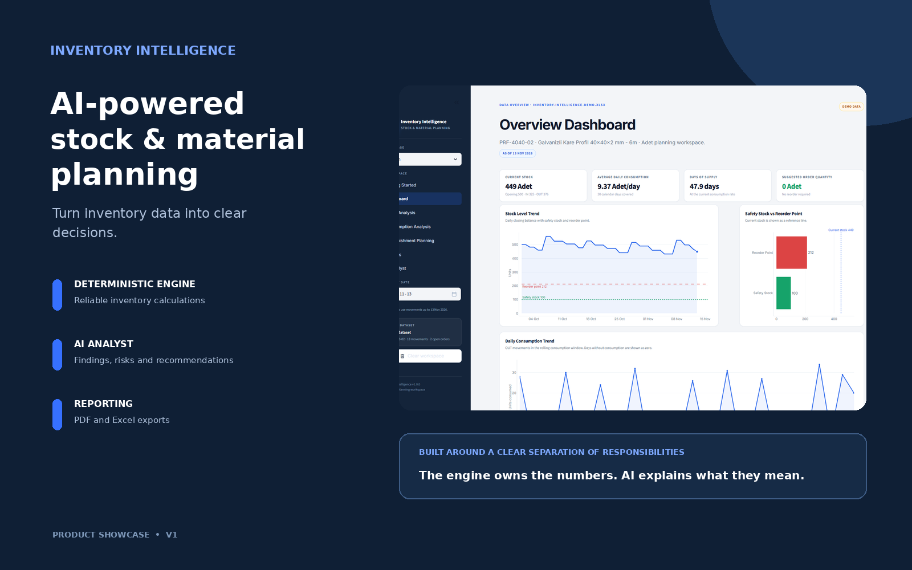

*Kapak görseli. Ürünün üç katmanı — deterministik motor, AI Analyst ve
raporlama — ve paketle gelen demo veri kümesinden üretilmiş Overview Dashboard.*

---

## İçindekiler

1. [Proje Hakkında](#1-proje-hakkında)
2. [Temel Özellikler](#2-temel-özellikler)
3. [AI Analyst — Akıllı Stok İçgörüleri](#3-ai-analyst--akıllı-stok-içgörüleri)
4. [Nasıl Çalışır?](#4-nasıl-çalışır)
5. [Deterministik Motor ve AI Katmanı](#5-deterministik-motor-ve-ai-katmanı)
6. [Raporlar ve Dışa Aktarma — PDF ve Excel](#6-raporlar-ve-dışa-aktarma--pdf-ve-excel)
7. [Uygulama Ekran Görüntüleri](#7-uygulama-ekran-görüntüleri)
8. [Teknoloji Yığını](#8-teknoloji-yığını)
9. [Kurulum](#9-kurulum)
10. [AI API Yapılandırması](#10-ai-api-yapılandırması)
11. [Proje Mimarisi](#11-proje-mimarisi)
12. [Test ve Kalite Güvencesi](#12-test-ve-kalite-güvencesi)
13. [Sınırlamalar](#13-sınırlamalar)
14. [Güvenlik Notları](#14-güvenlik-notları)

---

## 1. Proje Hakkında

Inventory Intelligence, tek bir Excel dosyasını tek bir stok kalemi (SKU) için
çalışan bir karar yüzeyine dönüştürür. Stok matematiğini elektronik tablolarda
yeniden kurmak yerine, dosyayı bir kez yüklersiniz ve uygulama tüm tabloyu ondan
türetir: elde ne kadar stok var, ne hızda tükeniyor, ne zaman sipariş gerekir ve
sipariş ne kadar olmalı.

Ürün, sorumlulukların kesin biçimde ayrılması üzerine kuruludur:

| Katman | Sorumluluk |
| --- | --- |
| **Hesaplama motoru** | Her sayının sahibi. Güncel stok, tüketim, eşikler ve sipariş önerileri, arayüz bağımlılığı olmayan bir Python paketinde üretilir. |
| **Arayüz** | Yalnızca sunar. Hiçbir ekran bir metriği yeniden hesaplamaz. |
| **AI Analyst** | Yalnızca açıklar. Motor değerlerini alır ve bunlar hakkında metin yazar; hiçbir değeri değiştiremez. |

V1 bilinçli olarak dardır — tek ürün, tek depo, tek dosya. Bu kısıt her hesaplamayı
denetlenebilir ve kapsamı dürüst tutar.

> **Kapsam notu.** Paketle birlikte gelen veri kümesi sentetiktir ve arayüzün
> tamamında demo verisi olarak açıkça etiketlenmiştir.

---

## 2. Temel Özellikler

### Veri sözleşmesi ve doğrulama

- **Yapılandırılmış Excel sözleşmesi.** Üç zorunlu sayfa (`Product Master`,
  `Stock Movements`, `Open Orders`) ve sabit sütun adları; herhangi bir hesap
  yapılmadan önce doğrulanır.
- **Satır düzeyinde doğrulama geri bildirimi.** Her sorun bir kod, bir önem düzeyi
  ve seçili arayüz dilinde anlaşılır bir mesajla bildirilir.
- **Demo ve yükleme izolasyonu.** Sentetik demo verisi ile kendi yüklediğiniz dosya
  aynı çalışma alanında asla bir arada bulunmaz.

### Deterministik hesaplama

- **Güncel stok, hareketli ortalama günlük tüketim, stok yeterlilik günü.** 30
  takvim günlük hareketli pencere üzerinden hesaplanır; hareket olmayan günler
  atlanmaz, sıfır tüketim olarak sayılır.
- **Yeniden sipariş noktası, hedef stok, stok pozisyonu, önerilen sipariş
  miktarı.** Tümü doğrulanmış dosyadan ve kenar çubuğundaki rapor tarihinden
  türetilir.
- **Geçmiş rapor tarihleri.** Geçmiş bir tarih seçildiğinde, hangi planlama
  değerlerinin bilinçli olarak kullanılamadığı tahmin yürütülmeden açıklanır.

### Arayüz

- **Yedi ekran** — Getting Started, Overview Dashboard, Stock Analysis,
  Consumption Analysis, Replenishment Planning, Reports ve AI Analyst.
- **Etkileşimli grafikler** — stok bakiye trendi, günlük ve haftalık tüketim,
  emniyet stoğu ile yeniden sipariş noktası karşılaştırması.
- **İki dilli arayüz** — eksiksiz İngilizce ve Türkçe arayüz, yerel ayara duyarlı
  sayı ve tarih biçimlendirmesi.
- **Sessiz hata yok** — eksik API anahtarı, erişilemeyen sağlayıcı veya kesilmiş
  yanıt görünür bir mesaj üretir; deterministik değerler yerinde kalır.

### Çıktı

- **Excel ve PDF raporlama** — beş sayfalık bir çalışma kitabı ve yedi bölümlük A4
  PDF; ikisi de aynı hesaplama sonucundan üretilir.
- **İsteğe bağlı AI yorumu** — stok içgörüleri, tüketim içgörüleri, yeniden sipariş
  açıklaması ve serbest sorular; veri kümesi ve rapor tarihi başına önbelleklenir.

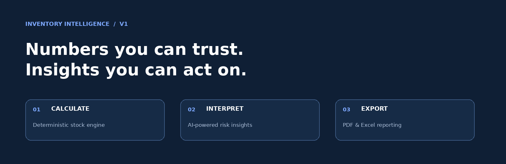

*Ürün üç adımda — deterministik hesaplama, AI yorumu ve PDF/Excel dışa aktarma.*

---

## 3. AI Analyst — Akıllı Stok İçgörüleri

AI Analyst, deterministik motorun üzerinde isteğe bağlı bir yorum katmanıdır.
Otonom bir planlayıcı değil, sınırları belirlenmiş bir istemcidir: motorun ürettiği
sayıları okur ve bunları sade bir dille açıklar.

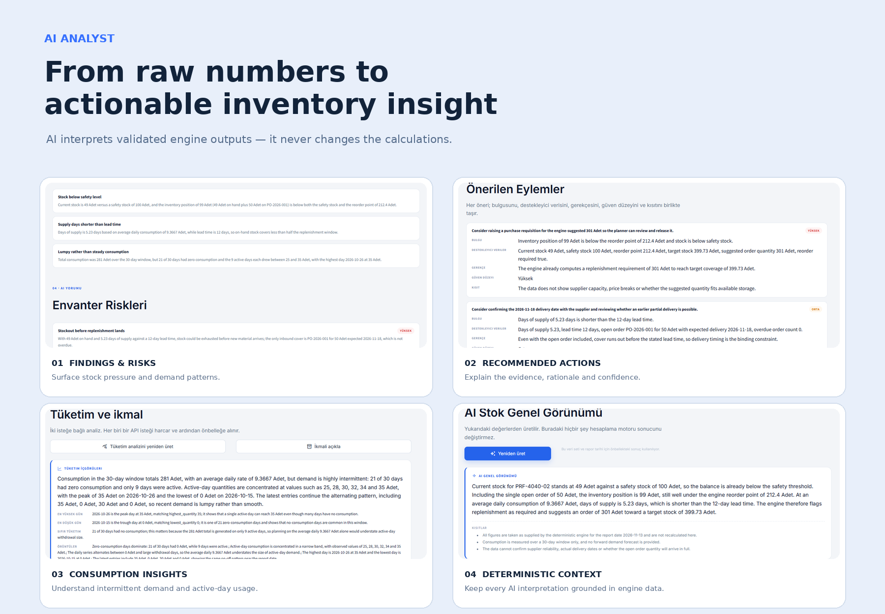

*AI Analyst'in dört çıktı yüzeyi tek karede: bulgular ve riskler, destekleyici
verisi ve güven düzeyiyle önerilen eylemler, tüketim içgörüleri ve stok genel
görünümü. Türkçe panel başlıkları iki dilli arayüzü örnekler; model çıktısının
kendisi İngilizcedir.*

> **Rakamlar hakkında not.** Bu paneller, bu belgenin geri kalanında kullanılan
> demo çalışma alanından **farklı bir veri kümesi durumuna** aittir: elde 49 Adet
> ve 301 Adet önerilen sipariş; oysa demo çalışma kitabında 449 Adet ve yeniden
> sipariş yok. Bu nedenle rakamlar **örnek niteliğindedir ve diğer ekran
> görüntüleriyle aynı oturuma ait değildir**. AI çıktısının nasıl göründüğünü
> gösterirler, demo sonuçlarını değil.

### Ne yapar

| Yetenek | Açıklama |
| --- | --- |
| **AI ile üretilen stok genel görünümü** | Yalnızca motor değerlerinden türetilen, mevcut stok durumunun anlatı özeti. |
| **Otomatik bulgular ve risk tanımlama** | Her biri başlık, önem düzeyi ve ayrıntı satırı içeren yapılandırılmış bulgular ve riskler. |
| **Aksiyon önerileri** | Destekleyici veri, gerekçe ve açık bir güven düzeyi ile sınırlama içeren öneriler. |
| **Tüketim örüntüsü analizi** | Tüketim penceresinin özeti; zirve gün, en düşük gün, sıfır tüketim notları ve gözlenen örüntüler. |
| **Yeniden sipariş içgörüleri** | Sipariş gerekip gerekmediğinin gerekçesi; destekleyici veri ve uyarı notlarıyla. |
| **Doğal dille stok soru-cevap** | Etkin veri kümesi hakkında serbest sorular ve tek tıkla kullanılabilen altı önerilen soru. |
| **Deterministik veriye dayandırma** | Modelin atıf yapmasına izin verilen her değer, destekleyici veri panelinde gösterilen motor sonucundan gelir. |
| **Hesaplamalara dokunmadan yorumlama** | AI hiçbir zaman motora, dashboard'a veya raporlara geri yazmaz. |

### Ne yapamaz

- **Bir hesaplamayı değiştiremez.** Destekleyici veri panelindeki her sayı
  `InventoryCalculation` nesnesinden gelir.
- **Kendi kendine çalışamaz.** İstek yalnızca bir AI düğmesine bastığınızda
  gönderilir ve her istek açık bir kullanıcı eylemidir.
- **Satın alma siparişi, çoklu SKU planı veya tahmin üretemez.** Bunlar V1
  kapsamı dışındadır.
- **Sessizce başarısız olamaz.** Sağlayıcı hataları ve kesilmiş yanıtlar uyarı
  bandı olarak görünür; deterministik değerler ekranda kalır.

### İstekler nasıl kontrol edilir

- Yanıtlar katı Pydantic şemalarına göre doğrulanır: listeler en fazla **15
  öğe**, metin alanları en fazla **1.200 karakter**, tek öğeler en fazla **400
  karakter**.
- Her başarılı sonuç **bağlam parmak izi + işlem** anahtarıyla önbelleklenir; böylece
  bir Streamlit yeniden çalışması isteği tekrarlamaz ve aynı soru iki kez
  faturalandırılmaz. Hatalar asla önbelleklenmez.
- Belirteç sınırına takılan yanıt (`finish_reason == "length"`) eksik kabul edilir
  ve tamamlanmış gibi sunulmaz.
- Açık satın alma siparişleri hiçbir aşamada güncel stoğa eklenmez ve AI'a bu kural
  açıkça bildirilir.

### Dil

**Arayüz** tamamen çevrilidir. **Model çıktısı İngilizcedir** — istem İngilizce metin
ister ve yanıtlar olduğu gibi gösterilir. AI Analyst ekranı bunu açıkça belirtir;
böylece Türkçe arayüzde sürpriz yaşanmaz.

---

## 4. Nasıl Çalışır?

İş akışı sekiz adımdan oluşur ve aynı adımlar Getting Started ekranında gösterilir.

1. **Excel Şablonunu İndir** — gerekli sayfa ve sütunları zaten içeren bir çalışma
   kitabıyla başlayın.
2. **Ürün ve Stok Verisini Girin** — SKU, açılış stoğu, emniyet stoğu ve planlama
   parametrelerini ekleyin.
3. **Excel Dosyasını Yükleyin** — dosya etkin hale gelmeden önce her sayfa
   doğrulanır.
4. **Stok Dashboard'ını İnceleyin** — güncel stok, stok yeterlilik günü, yeniden
   sipariş noktası ve önerilen sipariş miktarını kontrol edin.
5. **Tüketimi Analiz Edin** — hareket olmayan günler dahil günlük ve haftalık OUT
   tüketimini inceleyin.
6. **Yeniden Sipariş Önerilerini İnceleyin** — stok pozisyonunu yeniden sipariş
   noktasıyla karşılaştırın ve açık satın alma siparişlerini gözden geçirin.
7. **AI Analyst'e Sorun** — isteğe bağlı olarak sade dille bir açıklama isteyin (API
   anahtarı gerekir).
8. **Excel veya PDF Raporlarını Dışa Aktarın** — seçili rapor tarihi için
   biçimlendirilmiş bir çalışma kitabı veya sunuma hazır bir PDF indirin.

### Hesaplama modeli

| Metrik | Formül |
| --- | --- |
| Güncel Stok | Açılış Stoğu + IN hareketleri − OUT hareketleri, rapor tarihine kadar |
| Ortalama Günlük Tüketim | Tüketim penceresindeki OUT miktarı ÷ penceredeki takvim günü sayısı |
| Stok Yeterlilik Günü | Güncel Stok ÷ Ortalama Günlük Tüketim (tüketim sıfırsa `—`) |
| Yeniden Sipariş Noktası | Ortalama Günlük Tüketim × Tedarik Süresi (gün) + Emniyet Stoğu |
| Hedef Stok | Ortalama Günlük Tüketim × (Tedarik Süresi + Hedef Kapsam Günü) + Emniyet Stoğu |
| Stok Pozisyonu | Güncel Stok + tüm açık sipariş miktarları |
| Sipariş Gerekli | Stok Pozisyonu ≤ Yeniden Sipariş Noktası (dahil) |
| Önerilen Sipariş Miktarı | Sipariş gerekmiyorsa `0`; aksi halde ceil(Hedef Stok − Stok Pozisyonu) |

### Örnek hesap

Paketle gelen demo çalışma kitabı ve 13 Kasım 2026 rapor tarihi ile:

| Değer | Sonuç |
| --- | --- |
| Güncel Stok | 449 Adet |
| Ortalama Günlük Tüketim | 9,37 Adet/gün |
| Stok Yeterlilik Günü | 47,9 gün |
| Yeniden Sipariş Noktası | 212,4 Adet |
| Hedef Stok | 399,7 Adet |
| Açık Sipariş Miktarı | 300 Adet |
| Stok Pozisyonu | 749 Adet |
| Önerilen Sipariş Miktarı | 0 Adet |

Stok Pozisyonu (749) Yeniden Sipariş Noktası'nın (212,4) üzerinde olduğu için
sipariş gerekmez ve öneri sıfırdır. Bu sayılar paketteki dosyadan yeniden
üretilebilir; sabit kodlanmış değildir.

### Excel veri yapısı

Çalışma kitabı, girdinin tamamını oluşturan sözleşmedir. Üç sayfa zorunludur ve
adları ile sütunları aşağıdaki gibi olmalıdır.

**`Product Master`** — tek SKU'yu tanımlayan tek satır:

| Sütun | Anlam |
| --- | --- |
| `Product Code` | SKU kimliği |
| `Product Name` | Görünen ad |
| `Unit` | Ölçü birimi (örneğin `Adet`) |
| `Opening Stock` | Açılış tarihindeki stok seviyesi |
| `Opening Stock Date` | Hareket geçmişinin başlangıcı |
| `Safety Stock` | Asgari planlama tamponu |
| `Lead Time Days` | Beklenen tedarikçi tedarik süresi |
| `Target Coverage Days` | Hedef stoğun sağlaması gereken kapsam |

**`Stock Movements`** — her hareket için bir satır:

| Sütun | Anlam |
| --- | --- |
| `Date` | Hareket tarihi |
| `Transaction Type` | `IN` veya `OUT` |
| `Quantity` | Pozitif miktar |
| `Description` | Serbest metin notu |

**`Open Orders`** — teslimat bekleyen her satın alma siparişi için bir satır:

| Sütun | Anlam |
| --- | --- |
| `Order No` | Benzersiz sipariş numarası |
| `Order Quantity` | Sipariş edilen miktar |
| `Expected Delivery Date` | Taahhüt edilen teslim tarihi |

### Demo verisi

Paketle gelen demo çalışma kitabı sentetiktir ve yalnızca uygulamanın veri
hazırlamadan keşfedilebilmesi için vardır. Arayüzde demo verisi olarak etiketlenir
ve yüklenen bir çalışma kitabıyla asla karışmaz.

---

## 5. Deterministik Motor ve AI Katmanı

Bu sınır, projenin merkezi tasarım kararıdır.

| | Deterministik Motor | AI Analyst |
| --- | --- | --- |
| **Rolü** | Tüm sayılar için tek doğruluk kaynağı | Bu sayılar üzerinde yorum katmanı |
| **Ürettiği** | Stok, tüketim, eşikler, sipariş önerisi | Anlatı özeti, bulgular, riskler, aksiyonlar, soru-cevap |
| **Bir değeri değiştirebilir mi** | Evet — değerleri o tanımlar | **Hayır** |
| **Deterministik mi** | Evet — aynı girdi, aynı çıktı | Hayır — model çıktısı değişkendir |
| **Ağ gerektirir mi** | Hayır | Evet, yalnızca açık kullanıcı eyleminde |
| **Uygulamayı kullanmak için gerekli mi** | Evet | Hayır — tamamen isteğe bağlı |

```text
Excel dosyası
      │
      ▼
┌─────────────────────────┐
│  Doğrulama motoru       │  hatalı dosyaları reddeder
└───────────┬─────────────┘
            ▼
┌─────────────────────────┐
│  Hesaplama motoru       │  ← sayıların TEK kaynağı
│  (core/, Streamlit yok) │
└───────────┬─────────────┘
            │  tek bir InventoryCalculation nesnesi
   ┌────────┼────────┬─────────────┐
   ▼        ▼        ▼             ▼
Ekranlar  Grafikler Excel/PDF   AI Analyst
                                (değerleri okur,
                                 yazamaz)
```

AI katmanı devre dışıysa, erişilemiyorsa veya hata veriyorsa **tüm deterministik
ekranlar ve iki rapor da tamamen aynı şekilde çalışır**.

---

## 6. Raporlar ve Dışa Aktarma — PDF ve Excel

İki çıktı aynı `ReportContext` nesnesinden üretilir; bu nedenle indirilen dosyalar
her zaman dashboard ile aynı değerleri taşır.

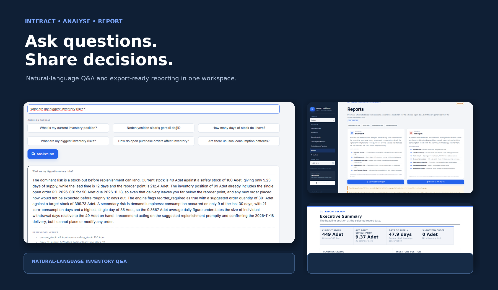

*Aynı çalışma alanının iki ucu: deterministik bağlamdan yanıtlanan doğal dil
sorusu (sol) ve iki dışa aktarma biçimiyle Reports ekranı ile üretilmiş PDF'in
yönetici özeti (sağ).*

> **Rakamlar hakkında not.** Sol ve sağ paneller **aynı oturuma ait değildir**.
> Soru-cevap yanıtı, elde 49 Adet ve 301 Adet önerilen sipariş içeren bir veri
> kümesi durumunu yansıtır; rapor paneli ise demo çalışma kitabını gösterir —
> 449 Adet, 9,37 Adet/gün ve yeniden sipariş yok. İkisi de gerçek üretilmiş
> çıktıdır, ancak iki farklı veri kümesi durumundan üretilmiş ve burada yalnızca
> sunum amacıyla bir araya getirilmiştir.

### Excel raporu — beş sayfa

| # | Sayfa | İçerik |
| --- | --- | --- |
| 1 | `Executive Summary` | Ürün, stok, tüketim ve yeniden sipariş değerleri tek sayfada |
| 2 | `Stock Movements` | Aralıktaki her IN ve OUT hareketi, kapanış bakiyesiyle |
| 3 | `Consumption Analysis` | Ortalama, toplam, en yüksek ve en düşük gün; günlük ve haftalık seriler |
| 4 | `Replenishment Plan` | Planlama eşikleri, stok pozisyonu ve önerilen sipariş |
| 5 | `Open Purchase Orders` | Sipariş miktarı, beklenen teslim tarihi ve gecikme durumu |

### PDF raporu — yedi bölüm

Rapor başlığı, yönetici özeti, stok analizi, tüketim analizi, yeniden sipariş
planlaması, açık satın alma siparişleri ve metodoloji ile notlar.

PDF, A4 dikey yönelimde, numaralı sayfalarla, dashboard ile aynı serilerden çizilen
grafiklerle ve Türkçe karakterlerin doğru görünmesi için gömülü bir TrueType
fontla üretilir.

### Rapor dil kapsamı

**Excel ve PDF dosyaları, arayüz dilinden bağımsız olarak İngilizce üretilir.**
Dashboard değerleri, grafikler ve arayüz seçili dili izler; rapor dosyaları
izlemez. Reports ekranı bunu açıkça belirtir. Raporlar mevcut hesaplamanın statik
anlık görüntüleridir ve formül içermez.

---

## 7. Uygulama Ekran Görüntüleri

Aşağıdaki görüntülerin tümü, paketle gelen sentetik demo veri kümesiyle çalışan
uygulamadan alınmıştır.

### Overview Dashboard

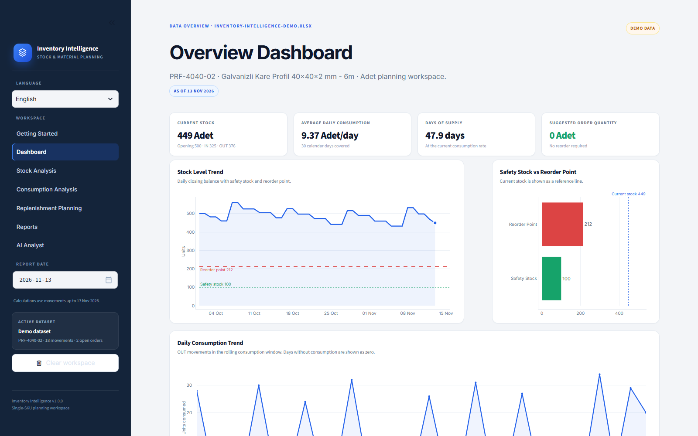

*Dört KPI kartı, stok seviyesi trendi, emniyet stoğu ile yeniden sipariş noktası
karşılaştırması, günlük tüketim trendi, stok durumu ve açık satın alma siparişi
tabloları.*

### Stock Analysis

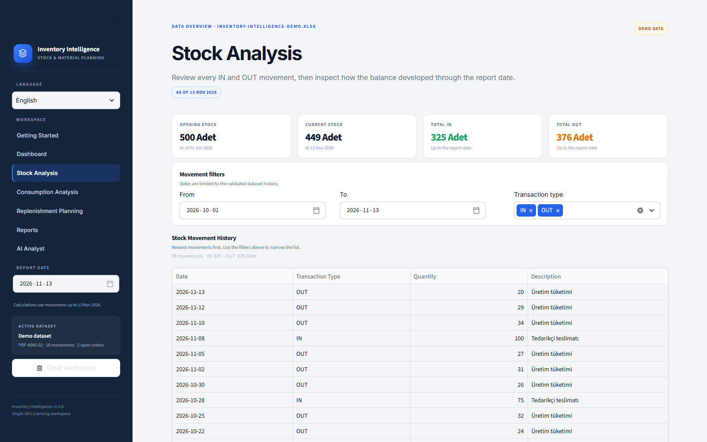

*Açılış ve güncel stok, toplam IN ve OUT, hareket filtreleri ve hareket
geçmişinin tamamı.*

### AI Analyst

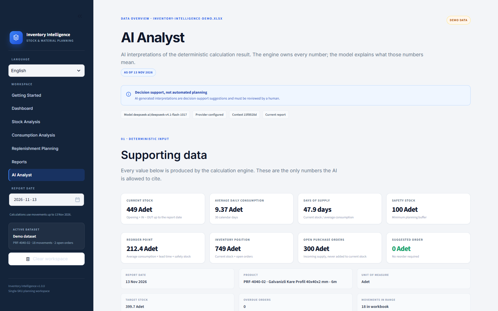

*Deterministik destekleyici veri paneli. Buradaki her değer hesaplama motorundan
gelir; AI yalnızca bu sayılara atıf yapabilir.*

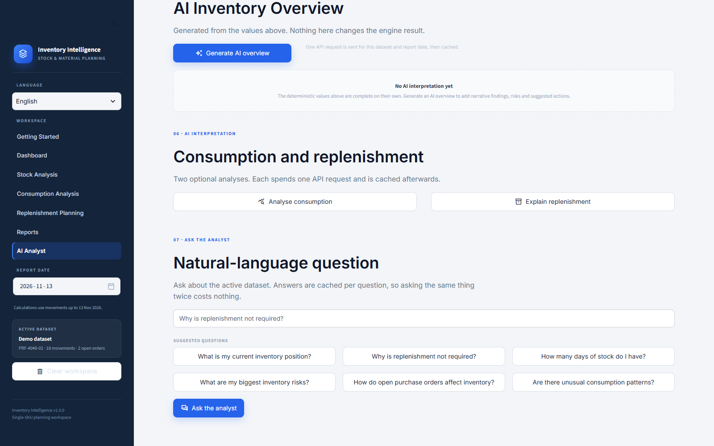

*AI bölümünün iskeleti: genel görünüm üreticisi, iki isteğe bağlı analiz ve
önerilen sorularla doğal dil soru kutusu.*

### Consumption Analysis

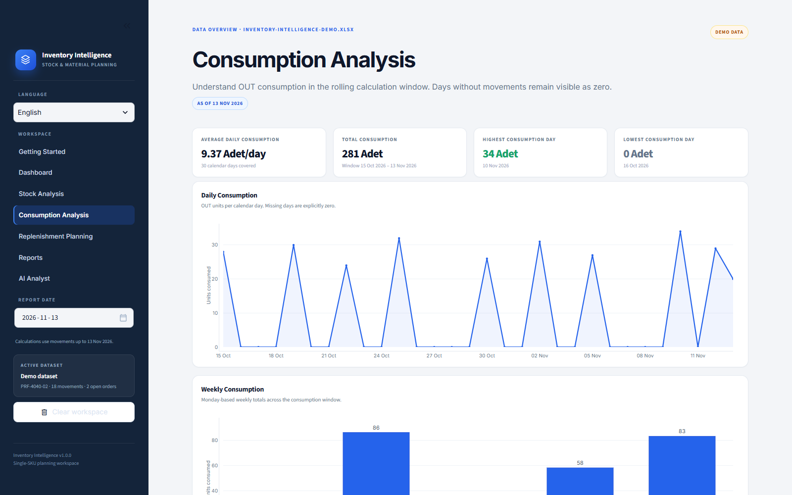

*Ortalama ve toplam tüketim, en yüksek ve en düşük gün, günlük çizgi grafiği ve
haftalık çubuk grafik. Hareket olmayan günler sıfır olarak görünür.*

### Replenishment Planning

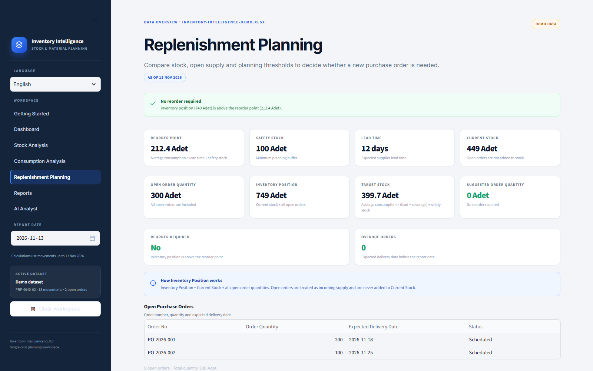

*Yeniden sipariş noktası, emniyet stoğu, tedarik süresi, stok pozisyonu, hedef
stok, önerilen sipariş, gecikmiş siparişler ve açık sipariş tablosu.*

### Reports

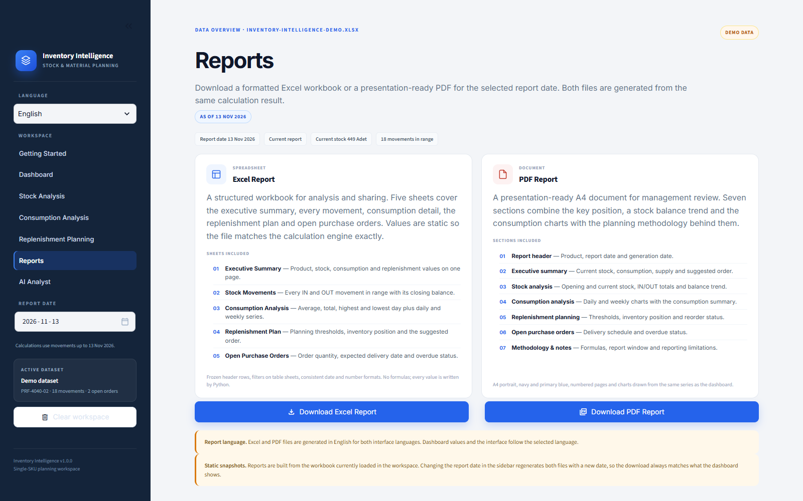

*İki çıktı biçimi yan yana, indirme düğmeleriyle.*

### PDF Raporu

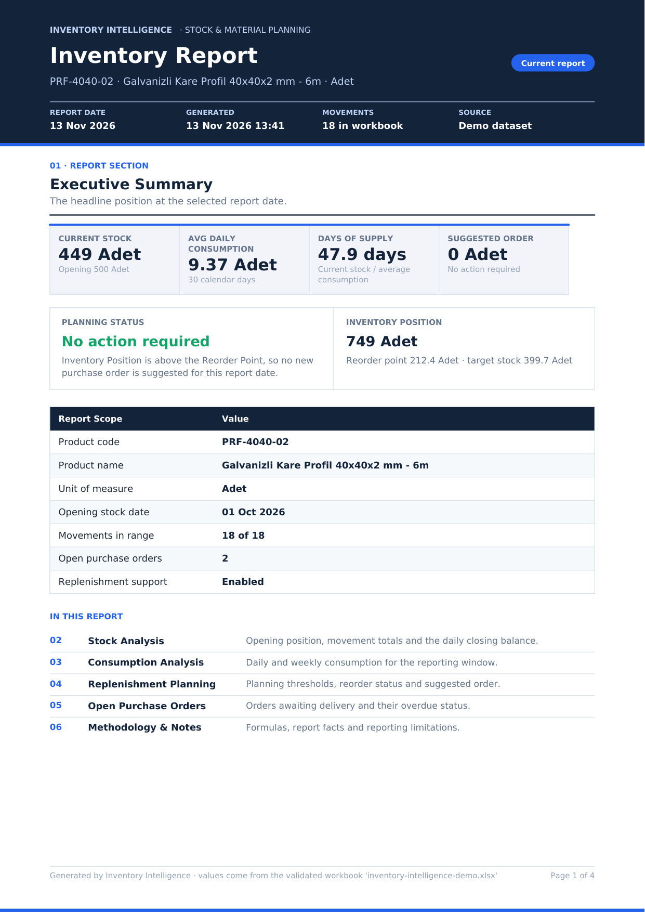

*Gerçekten üretilmiş bir A4 rapor — 4 sayfanın 1.'si, yönetici özeti.*

---

## 8. Teknoloji Yığını

| Katman | Seçim |
| --- | --- |
| Dil | Python 3.11+ (3.11, 3.12 ve 3.13 üzerinde doğrulandı) |
| Arayüz | Streamlit (1.53 ve 1.67 üzerinde doğrulandı) |
| Veri | pandas, openpyxl |
| Grafikler | Plotly |
| PDF | ReportLab |
| AI doğrulama | Pydantic v2 |
| AI taşıma | Yalnızca Python standart kütüphanesi `urllib` |
| Testler | pytest ve Streamlit `AppTest` |
| Lint | Ruff |
| CI | GitHub Actions, Python 3.11/3.12/3.13 matrisi |

AI istemcisi bilinçli olarak sağlayıcıya özel bir SDK bağımlılığı taşımaz: tek bir
küçük OpenAI uyumlu `chat/completions` çağrısı, hem bağımlılık yüzeyini hem de
incelenecek kod yüzeyini küçük tutar.

**Çalışma zamanı bağımlılıkları** (`requirements.txt`):

```text
streamlit>=1.53,<2.0
pandas>=2.2,<4.0
openpyxl>=3.1,<4.0
plotly>=5.24,<7.0
reportlab>=4.2,<5.0
pydantic>=2.7,<3.0
```

---

## 9. Kurulum

Gereksinim: **Python 3.11 veya üzeri**.

```bash
git clone https://github.com/mertkk1623/inventory-intelligence.git
cd inventory-intelligence

python -m venv .venv

# Windows
.venv\Scripts\activate

# macOS / Linux
source .venv/bin/activate

pip install -r requirements.txt
```

Geliştirme için, test paketi ve linter dahil:

```bash
pip install -r requirements-dev.txt
```

### Uygulamayı çalıştırma

```bash
streamlit run app.py
```

`streamlit` PATH üzerinde değilse:

```bash
python -m streamlit run app.py
```

Uygulama `http://localhost:8501` adresinde açılır.

### Testleri çalıştırma

```bash
python -m pytest -q
```

### Lint

```bash
python -m ruff check .
```

### Yükleme sınırları

`.streamlit/config.toml` tema ve 10 MB yükleme sınırını tanımlar; `config.py`
`MAX_UPLOAD_SIZE_MB` değerini ve izin verilen uzantıyı (yalnızca `.xlsx`) tutar.

---

## 10. AI API Yapılandırması

AI katmanı **isteğe bağlıdır ve yapılandırılmadıkça kapalıdır.** Anahtar olmadan
uygulama tamamen kullanılabilir: tüm deterministik ekranlar ve iki rapor da
çalışır, AI Analyst ekranı ise AI'ın kullanılamadığını açıklar.

### Yapılandırma önceliği

AI katmanı ayarlarını şu sırayla çözer:

1. `.streamlit/secrets.toml` (asla commit edilmez)
2. Ortam değişkenleri
3. Yerleşik varsayılanlar

### Yerel kurulum

`.streamlit/secrets.toml` dosyasını oluşturun:

```toml
# .streamlit/secrets.toml — bu dosya asla commit edilmemeli
AI_API_KEY = "your-api-key-here"
AI_BASE_URL = "https://api-cdn.deploy.com/api/v1"   # isteğe bağlı
AI_MODEL = "deepseek-ai/deepseek-v4.1-flash-1017"   # isteğe bağlı
```

Kabul edilen anahtar adları `AI_API_KEY` ve `DEPLOY_API_KEY`'dir. `AI_BASE_URL` ve
`AI_MODEL` isteğe bağlı geçersiz kılmalardır.

### Streamlit Cloud

Sırlar dosyasını **commit etmeyin**. Streamlit Cloud panelinde:

**⋮ → Settings → Secrets** yolunu izleyip şunu yapıştırın:

```toml
AI_API_KEY = "your-api-key-here"
```

Kaydedin; uygulama otomatik olarak yeniden başlar. Varsayılan dışında bir sağlayıcı
kullanacaksanız `AI_BASE_URL` ve `AI_MODEL` de aynı yolla eklenebilir.

### Varsayılan sağlayıcı ayarları

| Ayar | Değer |
| --- | --- |
| Temel URL | `https://api-cdn.deploy.com/api/v1` |
| Uç nokta | `POST /chat/completions` |
| Kimlik doğrulama | `Authorization: Bearer <key>` |
| Model | `deepseek-ai/deepseek-v4.1-flash-1017` |
| `max_tokens` | 4000 (en az anlamlı bütçe olarak 3000 taban uygulanır) |
| `temperature` | 0.2 |
| Zaman aşımı | 60 sn |
| Yeniden deneme | 2, yalnızca 429/500/502/503/504 için |

---

## 11. Proje Mimarisi

```text
inventory-intelligence/
├── app.py                    Streamlit giriş noktası ve sayfa yönlendirme
├── config.py                 Yollar, uygulama bilgileri, yükleme sınırları
├── pyproject.toml            Ruff ve pytest yapılandırması
├── requirements.txt          Çalışma zamanı bağımlılıkları
├── requirements-dev.txt      Çalışma zamanı + pytest + Ruff
├── .streamlit/config.toml    Tema ve yükleme yapılandırması
├── .github/workflows/ci.yml  Lint ve test matrisi
├── core/                     Framework bağımsız alan katmanı
│   ├── schema.py             Kanonik Excel sayfa/sütun sözleşmesi
│   ├── models.py             Alan modelleri ve hesaplama sonucu
│   ├── excel_reader.py       Çalışma kitabı okuyucu
│   ├── validation.py         Doğrulama motoru ve sorun bildirimi
│   ├── inventory.py          Güncel stok ve bakiye geçmişi
│   ├── consumption.py        Hareketli ortalama günlük tüketim
│   ├── replenishment.py      Yeniden sipariş noktası, hedef stok, sipariş önerisi
│   └── calculations.py       Tek InventoryCalculation nesnesini oluşturur
├── analytics/series.py       Sonuçtan türetilen gösterim serileri
├── ai/                       İsteğe bağlı AI katmanı (client, prompts, schemas, cache)
├── reports/                  Excel ve PDF üreticileri, PDF tema/grafikleri
├── components/               Ekranlar, grafikler, kenar çubuğu, stiller, UI yardımcıları
├── utils/                    i18n, session state, veri yükleme, hesaplama önbelleği
├── templates/                Excel şablonu ve sentetik demo çalışma kitabı
├── docs/screenshots/         Bu README'de kullanılan ürün ekran görüntüleri
└── tests/                    pytest paketi
```

`core/` paketi **Streamlit'i asla içe aktarmaz**. Bu sınır, motoru tarayıcı olmadan
test edilebilir kılan ve ekranları yalnızca sunum katmanı olarak tutan şeydir.

### Oturum izolasyonu

AI yanıt önbelleği modül düzeyinde değil `st.session_state` içinde yaşar; böylece
bir tarayıcı oturumu, önbelleklenmiş AI çıktısını başka bir oturumla asla
paylaşmaz. Dil seçimi de aynı şekilde oturuma bağlıdır.

---

## 12. Test ve Kalite Güvencesi

| Öğe | Sonuç |
| --- | --- |
| Otomatik testler | **190**, 7 modülde |
| Doğrulanan Python | 3.11, 3.12, 3.13 |
| Doğrulanan Streamlit | 1.53, 1.67 |
| Lint | Ruff, temiz |
| CI | GitHub Actions — 3.11/3.12/3.13 matrisinde lint + test |

### Test dağılımı

| Modül | Test |
| --- | --- |
| `test_ai.py` | 77 |
| `test_dashboard.py` | 29 |
| `test_reports.py` | 29 |
| `test_excel_validation.py` | 21 |
| `test_calculations.py` | 20 |
| `test_i18n.py` | 12 |
| `test_app.py` | 2 |
| **Toplam** | **190** |

Paket; Excel sözleşmesini ve reddetme yollarını, her hesaplama formülünü, rapor
üretimini, AI şema doğrulaması ve önbellekleme kurallarını, iki dilli
render'ı ve `AppTest` üzerinden Streamlit uygulama kabuğunu kapsar.

### Sürekli entegrasyon

`.github/workflows/ci.yml`, `main` dalına her push ve pull request'te Ruff ile tam
pytest paketini Python 3.11, 3.12 ve 3.13 üzerinde `ubuntu-latest` ortamında
çalıştırır. İş akışı mevcut commit üzerinde başarıyla çalışmıştır.

---

## 13. Sınırlamalar

Bunlar kusur değil, bilinçli V1 sınırlarıdır.

- **Tek SKU, tek depo.** Çalışma kitabı başına tek ürün satırı.
- **Tahmin yok.** Tüketim geçmişe dönük ölçülür, projeksiyon yapılmaz.
- **ABC analizi ve stok optimizasyonu yok.** İkisi de V2/V3 kapsamındadır.
- **ERP veya muhasebe entegrasyonu yok.** Tek girdi çalışma kitabıdır.
- **Geçmiş rapor tarihleri sipariş önerisi üretmez.** Güncel açık siparişler
  bugünün tedarikini tanımlar, geçmiş bir tarihteki tedariki değil; bu nedenle
  Stok Pozisyonu'na dahil edilmezler ve öneri bir açıklamayla bastırılır.
- **Excel ve PDF raporları yalnızca İngilizcedir.** Arayüz ve dashboard'lar iki
  dillidir; rapor dosyaları değildir.
- **AI çıktısı yalnızca İngilizcedir** ve harici bir sağlayıcıya bağımlıdır.
- **Yalnızca oturum durumu.** Sayfanın tamamen yenilenmesi çalışma alanını
  temizler.
- **Kimlik doğrulama yok.** V1 giriş ekranı içermez.
- **AI katmanı karar desteğidir.** Otomatik planlama değildir ve her çıktı insan
  incelemesi gerektirir.
- **Geçmiş tüketim penceresi kısa olabilir.** Çalışma kitabı 30 günden az veri
  kapsıyorsa ortalama, mevcut günler üzerinden hesaplanır.

---

## 14. Güvenlik Notları

- **Hiçbir API anahtarı commit edilmez.** `.gitignore`; `.streamlit/secrets.toml`,
  `.env`, `.env.*`, `*.pem` ve `*.key` dosyalarını hariç tutar. Depoda kimlik
  bilgisi yoktur.
- **Anahtarlar asla loglanmaz veya ekrana basılmaz.** Anahtar istek anında
  secrets ya da ortamdan okunur; çıktıya, loglara veya raporlara yazılmaz.
- **Kimlik bilgisi deponun değil, kurulumun sorumluluğundadır.** Streamlit
  Cloud'da anahtar uygulamanın Secrets panelinden verilir.
- **Tetiklediğiniz AI isteği dışında dışa çağrı yoktur.** Uygulama telemetri veya
  analitik çağrısı yapmaz; Streamlit kullanım istatistikleri
  `.streamlit/config.toml` içinde kapatılmıştır.
- **Çalışma zamanında diske yazma yoktur.** Yüklenen veri oturum boyunca bellekte
  tutulur ve diske hiçbir zaman yazılmaz.
- **V1 kimlik doğrulama sunmaz.** Gerçek ticari veriyi herkese açık bir kuruluma
  yüklemeyin.

---

<div align="center">

**Inventory Intelligence V1** · Tek SKU planlama çalışma alanı

[English](README.md) · [Türkçe](#inventory-intelligence)

</div>
